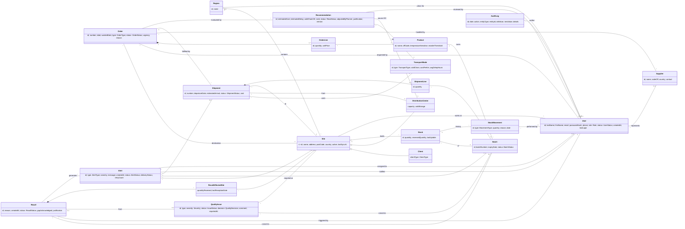

# Modèle de domaine unifié

**Base :** le diagramme de classes consolidé de MOGUO ([ClassDiagram_consolide_MOGUO.png](ClassDiagram_consolide_MOGUO.png) et [dictionnaire de données](MOGUO_ClassDiagram_et_dictionnaire.pdf)), lui-même construit à partir du [brouillon du groupe](ClassDiagram_brouillon_groupe.jpg).

**Compléments :** les classes et attributs que les différents UC exigent mais que le diagramme de groupe n'avait pas (marqués **➕**).

> C'est une **proposition de réconciliation** destinée à l'implémentation. Les noms suivent le diagramme du groupe chaque fois que c'est possible.

---

## 1. Table de synonymes (ce que disent les docs → ce qu'on code)

| Nom dans les livrables | Classe retenue | Remarque |
|---|---|---|
| `Medicine` (UC11 H'SAIN, UC15 BERTHAULT) | `Product` | |
| `StockItem`, `StockLevel` (UC11, UC15) | `Stock` | une ligne par (site, lot) |
| `Notification` (UC10, UC12, UC15), `RecallAlert` | `Alert` | avec destinataires (`recipients`) |
| `ExceptionalRequest`, `ReplenishmentRequest` (UC15) | `Order` avec `type = EXCEPTIONAL` | choix du diagramme de groupe |
| `RequestLine`, `OrderItem` (UC6, UC15), `OrderLine` | `OrderLine` | |
| `TransportOption` (UC10) | `TransportMode` (+ `Recommendation`) | |
| `AdjustmentLog` (UC10), `AuditEvent` (UC11) | `AuditLog` | |
| `Client`, pharmacie, hôpital, canal en ligne | `Client` (hérite de `Site`) | `clientType` |
| rôle `QUALITY` (MOGUO) | `QUALITY_OFFICER` | majorité des docs |

---

## 2. Diagramme (Mermaid)

---

## 3. Classes (attributs principaux)

Les attributs en **gras** sont des ajouts par rapport au diagramme de groupe, exigés par le UC indiqué.

| Classe | Attributs | Requis par |
|---|---|---|
| `User` | id, lastName, firstName, email (unique, sert de login), passwordHash, phone, role, status, createdAt, lastLogin | 2, tous |
| ➕ `Region` | id, name | 7, 10, 13, 15 (« la région du planner ») |
| `Site` (abstraite) | id, name, address, postCode, country, active, **lastSyncAt** | 14 (fraîcheur des données) |
| `Client` | clientType : PHARMACY / HOSPITAL / ONLINE | |
| `DistributionCenter` | capacity, coldStorage | 7, 10 |
| `Supplier` | id, name, codeOff, country, contact | 6 |
| `Product` | id, name, offCode, temperatureSensitive, **reorderThreshold** | 3, 14 (seuil de stock bas) |
| `Batch` | id, batchNumber, expiryDate, status | 3, 7, 11, 12, 14 |
| `Stock` | id, quantity (physique), **reservedQuantity** (réservations en ligne ou expédition), lastUpdate | 7, 14 (disponible = quantity − reservedQuantity, jamais < 0) |
| ➕ `StockMovement` | type (IN, OUT, ADJUSTMENT, TRANSFER), quantity, reason, date, user | 3 (historique), 11 (traçabilité même si le stock actuel vaut 0) |
| `Order` | id, number, date, **wantedDate**, type, status, **urgency**, **reason**, **partial** | 1, 7, 15 |
| ➕ `OrderLine` | product, quantity, unitPrice | 6, 15 |
| `Shipment` | id, number, departureDate, estimatedArrival, status, cost | 7, 9 |
| ➕ `ShipmentLine` | shipment, batch, quantity | 7, 9, **11 (traçabilité des lots)** |
| `TransportMode` | type, coldChain, **costPerKm**, **avgDelayHours** | 7 (calcul de la recommandation) |
| `Recommendation` | estimatedCost, estimatedDelay, coldChainOK, **rank** (1 = proposée, 2-3 = alternatives), status, **adjustedByPlanner**, **justification**, **version** (verrouillage optimiste) | 7, 10, 13 |
| `Alert` | type, **severity**, message, createdAt, status, **deliveryStatus** (PENDING, SENT, FAILED), **retryCount** | 3, 5, 9, 11 |
| ➕ `QualityIssue` | type (TEMPERATURE, SUPPLIER_RETURN, INSPECTION, SITE_REPORT), severity, status, decision, comment, reportedAt, handledBy | 12 |
| `Recall` | reason, createdAt, status, **gapAcknowledged**, **justification** | 11 |
| ➕ `RecallAffectedSite` | recall, site, quantityReceived, lastReceptionDate | 11 |
| `AuditLog` | date, action, entityType, entityId, oldValue, newValue, details, author | 2, 5, 10, 11, 12 |

> **Recommendation → Order, pas Shipment.** La recommandation existe avant l'expédition (UC13 : « aucune expédition n'est créée tant que la recommandation n'est pas validée »). Elle est donc rattachée à `Order` et devient la base du `Shipment` une fois validée.

---

## 4. Énumérations

| Enum | Valeurs | Source |
|---|---|---|
| `Role` | ADMIN, REGIONAL_PLANNER, PHARMACIST, QUALITY_OFFICER, SUPPLIER, PARTNER | 2 |
| `UserStatus` | PENDING, ACTIVE, INACTIVE | 2 |
| `ClientType` | PHARMACY, HOSPITAL, ONLINE | groupe |
| `TransportType` | REFRIGERATED_TRUCK, AIR_FREIGHT, STANDARD_TRUCK, COURIER | brief |
| `BatchStatus` | RELEASED, **QUARANTINED**, RECALLED, EXPIRED | groupe + 12, 14 |
| `MovementType` | IN, OUT, ADJUSTMENT, TRANSFER | 3 |
| `OrderType` | AUTOMATIC, EXCEPTIONAL | groupe |
| `OrderStatus` | PENDING, VALIDATED, PLANNED, SHIPPED, DELIVERED, REJECTED, CANCELLED | 1, 7, 15 (voir note) |
| `Urgency` | NORMAL, HIGH, CRITICAL | 15 |
| `ShipmentStatus` | PLANNED, IN_TRANSIT, DELIVERED, CANCELLED, INCIDENT | 7 |
| `RecoStatus` | PROPOSED, VALIDATED, ADJUSTED, REJECTED | 10, 13 |
| `AlertType` | LOW_STOCK, NEAR_EXPIRY, TEMPERATURE, DELAY, RECALL, QUALITY, REPLENISHMENT_REQUEST, RECOMMENDATION_CHANGED | 3, 5, 7, 10, 11, 15 |
| `AlertStatus` | NEW, IN_PROGRESS, RESOLVED, CLOSED | 5 (le plus détaillé) |
| `Severity` | LOW, MEDIUM, HIGH, CRITICAL | 5, 12 |
| `IssueStatus` | OPEN, IN_REVIEW, CLOSED | 12 |
| `QualityDecision` | QUARANTINE, MONITORING, CLOSE | 12 |
| `RecallStatus` | IN_PROGRESS, ACTIVE, ACTIVE_PARTIAL, CLOSED | 11 (TIH) |

**Correspondances à connaître :**

- **Statuts d'une demande exceptionnelle (UC15).** BERTHAULT utilise SUBMITTED et SUBMITTED_PARTIAL, JALAGUIER utilise Pending. On code `Order.status = PENDING` et `Order.partial = true/false`.
- **Rappel (UC11).** Le diagramme d'états de H'SAIN (Draft → Registered → Notification Pending → Issued / Attention Required) correspond à `IN_PROGRESS → ACTIVE / ACTIVE_PARTIAL`. L'état « Draft » n'est pas persisté.

---

## 5. Invariants métier (à faire respecter dans le Model ou le Controller)

1. `Stock.quantity ≥ 0` et `reservedQuantity ≤ quantity`.
2. Un lot `EXPIRED`, `QUARANTINED` ou `RECALLED` a une quantité disponible de 0 : il ne peut pas sortir du stock, être expédié, ni être ajouté à une commande.
3. Si `Product.temperatureSensitive`, alors le mode de transport retenu doit avoir `coldChain = true`.
4. Un seul `Recall` actif (IN_PROGRESS, ACTIVE ou ACTIVE_PARTIAL) par `Batch`.
5. Le rôle impose un rattachement :
   - PHARMACIST → `Site` obligatoire ;
   - REGIONAL_PLANNER → `Region` obligatoire (et `Site` facultatif) ;
   - SUPPLIER ou PARTNER → `Supplier` obligatoire ;
   - ADMIN et QUALITY_OFFICER → aucun rattachement.
6. Il existe toujours au moins un ADMIN actif. Aucun compte n'est supprimé physiquement : il est désactivé (RGPD et traçabilité).
7. Toute écriture sensible produit un `AuditLog`, dans la même transaction.
